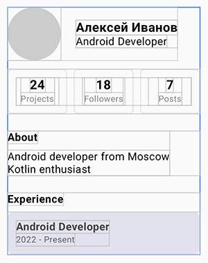

# Задание 1 - Jetpack Compose Layouts

### Задание и Результат работы

 

### Требования:
* Минимум 3 уровня вложенности
* Статистика через Row
* Инфоблоки через Column
* Опыт работы - отдельный Card
* Декоративные элементы - Box
* weight() там, где нужно
